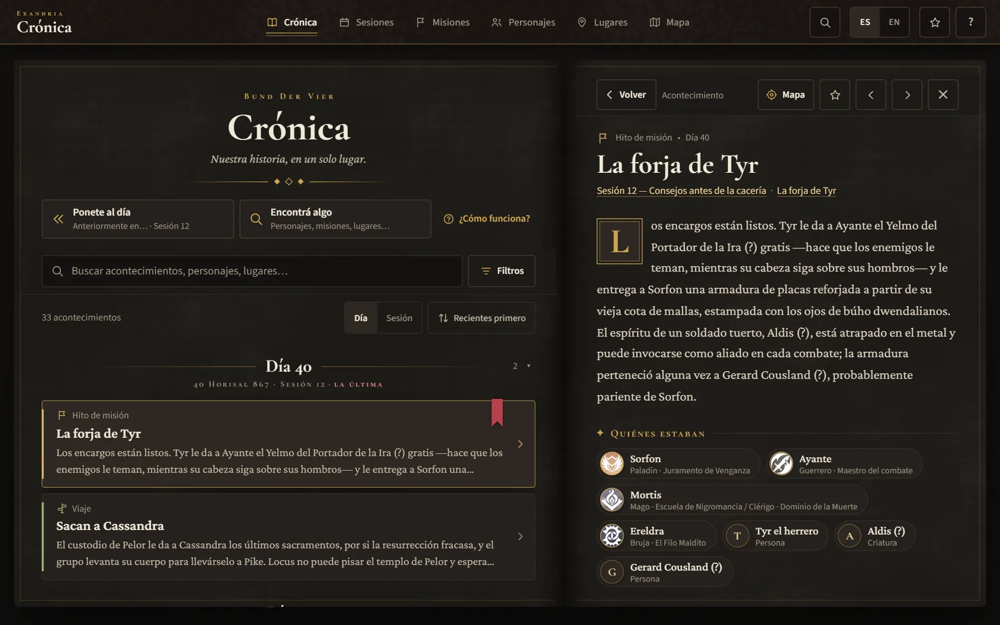
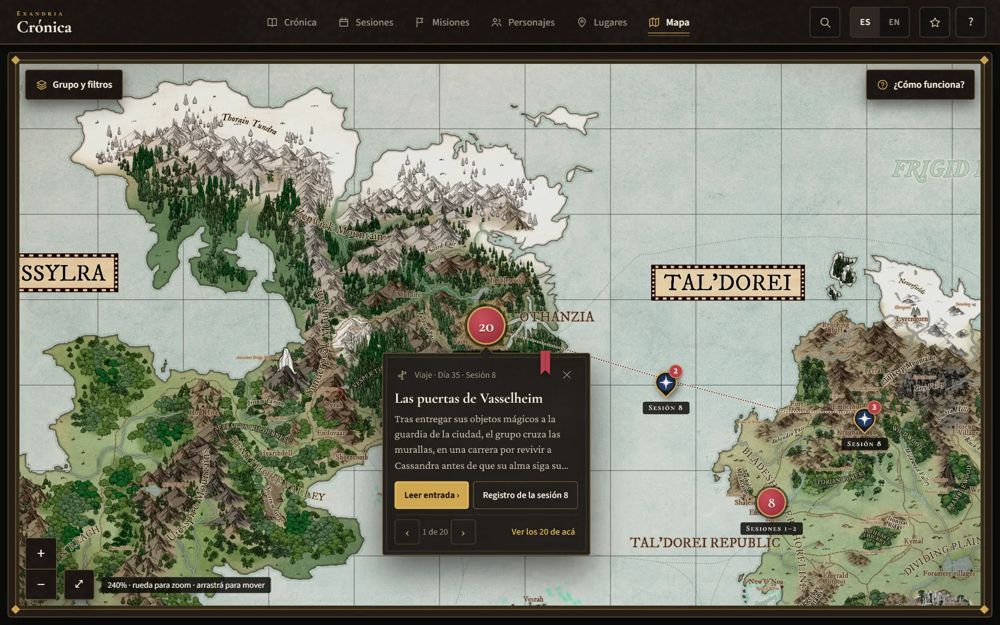
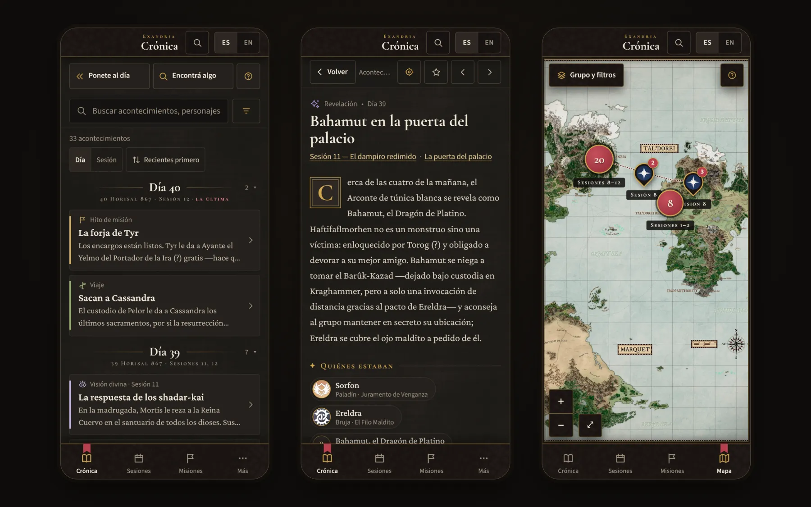

<!-- Presentación del proyecto. Mantener en sincronía con README.en.md. Los detalles técnicos viven en docs/ (en inglés). -->

<div align="center">

**Español** · [English](README.en.md)

# Crónica de Exandria

**Un atlas narrativo para preservar, explorar y revivir las aventuras de una campaña de Dungeons & Dragons.**

[**Abrir la crónica →**](https://bottadev.github.io/dnd-campaign-map/) · [Guía del Taller](docs/editor-guide.md) · [Documentación](#documentación)


HTML, CSS y JavaScript sin compilación · React 18 (vía dc-runtime) · Driver.js · Service Worker · IndexedDB · datos en JSON

</div>



## ¿Qué es Crónica de Exandria?

Es el archivo de las aventuras de *Bund Der Vier*, un grupo que juega una campaña de Dungeons & Dragons ambientada en Exandria, el mundo de Critical Role. Reúne en un solo lugar lo que normalmente queda disperso entre notas, chats y memoria: qué pasó en cada sesión, qué misiones siguen abiertas, quién es quién y dónde ocurrió cada cosa.

Está pensada para dos tipos de personas:

- **Quienes juegan**, para ponerse al día antes de una sesión, recordar un nombre o volver a leer una escena.
- **Quien lleva la crónica** —normalmente el DM—, para registrar cada sesión con formularios y ubicarla en el mapa, sin tocar código.

Cada acontecimiento está vinculado con su sesión, sus personajes, sus misiones y su lugar, y los lugares están en el mapa de Exandria: la narración y la geografía se recorren juntas. Desde una escena se salta al mapa; desde un marcador, a la escena; desde un personaje, a todo lo que vivió.

## Funcionalidades principales

<table>
<tr>
<td width="50%" valign="top">
<strong>Crónica y Sesiones</strong><br>
Una línea de tiempo de todos los acontecimientos, por día de campaña o por sesión, con filtros combinables. Cada sesión tiene su registro y un «Anteriormente en…» para ponerse al día.
</td>
<td width="50%" valign="top">
<strong>Misiones y Personajes</strong><br>
Las misiones por estado, con su historia sesión por sesión. El grupo, los personajes no jugadores, deidades y facciones, con sus relaciones y apariciones.
</td>
</tr>
<tr>
<td valign="top">
<strong>Atlas interactivo</strong><br>
El mapa de Exandria con zoom: marcadores por acontecimiento, grupos que se separan al acercarse y los recorridos registrados de cada personaje. Un índice jerárquico de lugares completa la geografía.
</td>
<td valign="top">
<strong>Búsqueda y navegación</strong><br>
Un buscador universal (<kbd>Ctrl</kbd>+<kbd>K</kbd>) en español e inglés, sin importar tildes; buscadores propios en cada sección, enlaces compartibles y favoritos.
</td>
</tr>
<tr>
<td valign="top">
<strong>Taller del Cronista</strong><br>
Un editor visual para quien lleva la crónica: sesiones, acontecimientos, misiones, personajes y lugares como formularios, con vista previa y validación.
</td>
<td valign="top">
<strong>Editor cartográfico</strong><br>
Colocar y ajustar marcadores sobre el mapa real con un clic, arrastrando o con el teclado. Las coordenadas se calculan solas y hay sugerencias a partir de lo registrado.
</td>
</tr>
<tr>
<td valign="top">
<strong>PWA y uso sin conexión</strong><br>
Después de una visita con conexión, la crónica se lee sin conexión y se puede instalar como app. El mapa en alta resolución sigue necesitando conexión.
</td>
<td valign="top">
<strong>Bilingüe, guiada y Grimorio</strong><br>
Interfaz y contenido en español e inglés, recorridos guiados sobre la interfaz real y un único tema oscuro de archivo encuadernado.
</td>
</tr>
</table>

La referencia completa de cada sección está en [docs/features.md](docs/features.md).

## Galería

<table>
<tr>
<td width="50%" valign="top"><br><sub><b>Atlas interactivo</b> · marcadores, grupos y el viaje de la sesión 8</sub></td>
<td width="50%" valign="top"><br><sub><b>Taller del Cronista</b> · formulario y vista previa</sub></td>
</tr>
<tr>
<td valign="top"><br><sub><b>Editor cartográfico</b> · un marcador por confirmar</sub></td>
<td valign="top"><br><sub><b>En el teléfono</b> · Crónica, acontecimiento y mapa</sub></td>
</tr>
</table>

## Taller del Cronista

El Taller es el escritorio donde se prepara la crónica antes de publicarla. Se abre desde la ayuda (**?** → última línea) o en [`#/taller`](https://bottadev.github.io/dnd-campaign-map/#/taller), sin instalar nada ni crear cuentas.

- **Sesiones y acontecimientos** con formularios: fechas, lugares, personajes, misiones, hilos abiertos y cerrados, efectos y «Anteriormente en…».
- **Misiones, personajes y lugares**: crear y editar, eligiendo todo de listas (nunca se escriben identificadores).
- **Vista previa** de cada página tal como se publicará, escribiendo en español o en inglés.
- **Editor cartográfico** para ubicar acontecimientos y lugares en el mapa.
- **Borradores locales** guardados solos en el navegador, con copias de seguridad y una copia descargable.
- **Validación y exportación**: las mismas reglas que el validador del repositorio, conflictos detectados campo por campo y un paquete `.zip` listo para incorporar.

> [!IMPORTANT]
> El Taller funciona sin backend propio: todo ocurre en tu navegador. **Exportar no equivale a publicar.** El paquete se incorpora al repositorio (con `tools/apply-draft.js` o desde GitHub) y recién entonces GitHub Pages publica la nueva versión. No hay sincronización automática entre dispositivos ni publicación directa.

**Del borrador a la crónica publicada:** editar en el Taller → se guarda como borrador en el navegador → validar → exportar el `.zip` → quien mantiene el repositorio lo incorpora → GitHub Pages publica.

### Editor cartográfico

- Abre el mapa real en modo edición: elegís un acontecimiento o un lugar y lo colocás con un clic o un toque.
- Ajuste fino arrastrando, con las flechas del teclado (un píxel de pantalla; <kbd>Mayús</kbd>, diez) o escribiendo las coordenadas. Nada cambia hasta **Confirmar**, y confirmar solo guarda en el borrador.
- Las posiciones son porcentajes de la imagen del mapa, iguales con cualquier zoom o pantalla; las sugerencias salen solo de lo registrado.

Guía paso a paso para el DM: **[docs/editor-guide.md](docs/editor-guide.md)** · Detalles técnicos: [docs/map-system.md](docs/map-system.md)

## Inicio rápido

Requiere Node.js (el proyecto usa la versión 22) y conexión a internet: React y las tipografías se cargan desde CDN.

```bash
git clone https://github.com/BottaDev/dnd-campaign-map.git
cd dnd-campaign-map
npm start            # http://localhost:5500 (npx serve)
```

No hay paso de compilación: se edita un archivo y se recarga la página. La app tiene que servirse por HTTP; abrirla con `file://` no carga los datos.

```bash
npm test             # validador + pruebas unitarias
npm run validate     # solo el validador de datos
npm install          # una vez, para las pruebas en navegador
npm run test:browser # Edge real (Windows: PowerShell o cmd)
```

Todos los comandos, la incorporación de un paquete del Taller y la solución de problemas: [docs/development.md](docs/development.md).

## Arquitectura

- **Aplicación estática:** `index.html` y scripts, sin servidor propio ni compilación; la interfaz es un componente React servido por dc-runtime (`support.js`).
- **Datos en JSON:** `data/*.json` (en inglés, la fuente) y `data/i18n/es-AR.json` (la traducción), leídos en el navegador por `js/chronicle-model.js`, que arma un modelo con todos los vínculos.
- **GitHub Pages:** publica la rama `main` tal cual; las rutas usan `#/…` y funcionan sin configuración.
- **Sin backend:** preferencias, favoritos e historial quedan en el navegador; un service worker guarda una copia para leer sin conexión.
- **Borradores locales:** el Taller guarda en IndexedDB y solo se descarga cuando se abre.
- **Exportación controlada:** `tools/apply-draft.js` aplica el paquete sobre los datos actuales, detecta conflictos y rechaza borradores con errores.

Más detalles en [docs/architecture.md](docs/architecture.md).

## Documentación

| Documento | Contenido |
|---|---|
| [Guía del Taller del Cronista](docs/editor-guide.md) | Para el DM: crear sesiones y acontecimientos, vincular, usar el editor cartográfico, guardar, recuperar, validar, exportar y entregar. |
| [Funcionalidades](docs/features.md) | Cada sección y herramienta: búsquedas, atajos de teclado, filtros, idiomas, enlaces y uso sin conexión. |
| [Arquitectura](docs/architecture.md) | Estructura, módulos, rutas, estado, persistencia local, service worker, el Taller por dentro y publicación estática. |
| [Modelo de datos](docs/data-model.md) | Los archivos JSON, identificadores, vínculos, traducciones y reglas de validación. |
| [Sistema del mapa](docs/map-system.md) | Coordenadas, marcadores, recorridos, zoom, editor cartográfico y sugerencias de posición. |
| [Sistema de diseño Grimorio](docs/design-system.md) | Concepto, tokens, paleta, tipografías, superficies, estados, íconos y accesibilidad. |
| [Desarrollo](docs/development.md) | Requisitos, comandos, pruebas, validación, incorporación de borradores, despliegue y problemas frecuentes. |
| [CLAUDE.md](CLAUDE.md) | Notas de trabajo para Claude Code. |

La guía del Taller está en español, como la interfaz que usa el DM; la documentación técnica está en inglés, como el código.

## Estado del proyecto

**En uso y mantenido junto con la campaña.** A octubre de 2026 registra 6 sesiones (1, 2, 8, 10, 11 y 12), 33 acontecimientos, 17 misiones, 42 personajes y 28 lugares; acontecimientos, sesiones, misiones y resúmenes de lore están traducidos al español.

**Por escribir** —nada se completa por inferencia—: las sesiones 3 a 7 y 9; el relato ampliado de los acontecimientos importantes; los resúmenes editoriales de «Anteriormente en…»; las posiciones propias de los lugares. `node tools/validate-data.js` informa el estado actual.

**Limitaciones:**

- Los borradores del Taller son locales a cada navegador y dispositivo: no hay sincronización.
- No hay publicación directa desde el Taller: requeriría un backend o guardar credenciales de GitHub en el navegador.
- Los recorridos del mapa y el Lore de Exandria se editan a mano en el repositorio.
- La primera visita necesita conexión, igual que el mapa en alta resolución.

**Alcance:** es el archivo de una campaña concreta, no un gestor de campañas genérico ni una mesa virtual (no tiene cuentas, dados ni fichas). Sus textos de marca viven en los diccionarios de la interfaz, así que puede adaptarse a otra campaña.

## Créditos y licencias

- *Dungeons & Dragons* es una marca de Wizards of the Coast. *Critical Role* y el mundo de *Exandria* pertenecen a sus respectivos titulares. Este es un proyecto de aficionados, sin afiliación ni respaldo oficial.
- El mapa de Exandria (`assets/exandria-map*.jpeg`) y los retratos de `assets/` no tienen una licencia declarada en este repositorio; sus derechos pertenecen a sus autores.
- Los resúmenes del Lore de Exandria son textos originales con enlaces a la [Critical Role Wiki](https://criticalrole.fandom.com/wiki/Critical_Role_Wiki), una wiki comunitaria cuyo texto se publica bajo CC BY-SA; no se copia texto ni imágenes de allí.
- [Driver.js](https://driverjs.com/) 1.8.0, © Kamran Ahmed, licencia MIT, incluido sin cambios en `vendor/driver.js/` junto con su licencia. React 18 (MIT) se carga desde unpkg.
- Tipografías Cormorant Garamond, Cormorant SC, Crimson Pro y Source Sans 3, servidas por Google Fonts bajo la SIL Open Font License.
- **Licencia del proyecto:** el repositorio no incluye un archivo de licencia, así que no se concede ningún permiso explícito para reutilizar su código ni su contenido.
