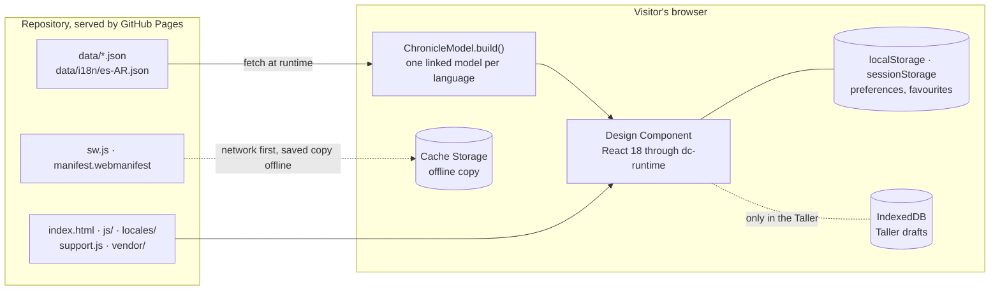
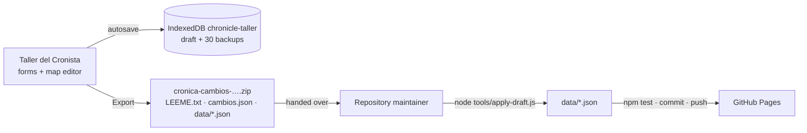

# Architecture

How Crónica de Exandria is built: a static single-page app with no backend and no build step, whose content is JSON in the repository and whose only "server" is GitHub Pages. This document covers the folder structure, the modules, routing, state, local persistence, the service worker and how the Taller del Cronista fits in without a backend.

← [Back to the README](../README.md) · Related: [Data model](data-model.md) · [Map system](map-system.md) · [Development](development.md) · [`CLAUDE.md`](../CLAUDE.md) (working notes for Claude Code)

**Contents:** [Overview](#overview) · [Repository layout](#repository-layout) · [How the page starts](#how-the-page-starts) · [Modules](#modules) · [The Design Component](#the-design-component) · [Navigation and routes](#navigation-and-routes) · [State and rendering](#state-and-rendering) · [Local persistence](#local-persistence) · [Internationalisation](#internationalisation) · [Guided tours](#guided-tours) · [The Taller del Cronista](#the-taller-del-cronista) · [Service worker and offline](#service-worker-and-offline) · [Static publishing](#static-publishing) · [Security notes](#security-notes) · [Design decisions](#design-decisions)

## Overview



- **Static files only.** `index.html` plus plain scripts; nothing to compile. React 18.3.1 comes from unpkg (with Subresource Integrity) and the fonts from Google Fonts.
- **Content is data.** Every session, event, quest, person and place lives in `data/*.json`; the page fetches it and builds a linked model in the browser.
- **No backend.** There is no server code, database, account or API. Personal state (preferences, favourites, history, Taller drafts) stays in the visitor's browser.
- **Publishing is a commit.** A change reaches readers only when it is committed to `main` and GitHub Pages serves it.

## Repository layout

```
index.html               the app: template, styles and Component logic (a dc-runtime Design Component)
support.js               generated dc-runtime bundle that loads React — do not edit
js/chronicle-model.js    data layer: normalisation, translations, links, filters, searches, validation
js/chronicle-map.js      map geometry: route lines, pins per coordinate, zoom-dependent groups
js/chronicle-library.js  favourites + recently viewed (localStorage)
js/chronicle-tour.js     guided tours: steps, versioned onboarding flags, the Driver.js runtime
js/chronicle-editor.js   the Taller's data core (no DOM): coordinates, drafts, conflicts, export, storage
js/chronicle-taller.js   the Taller del Cronista and the map editor's panel (UI), loaded on demand
js/i18n.js               translation function t(), plural forms, language preference
locales/en.js, es-AR.js  interface strings, one dictionary per language (same keys)
locales/taller.*.js      the Taller's strings, loaded with it and merged into the dictionaries
vendor/driver.js/        Driver.js 1.8.0 (MIT), unchanged npm copy: the tours' highlight and popover
sw.js                    service worker: the offline copy
manifest.webmanifest     web app manifest (name, icons, dark colours)
data/                    campaign content (see data-model.md)
assets/                  map images, portraits, party seal, app icons, textures (assets/textures/)
tools/                   validate-data.js, apply-draft.js, make-icons.mjs, make-textures.mjs
tests/                   unit tests (node --test) and real-browser checks (tests/browser/)
docs/                    this documentation and its screenshots (docs/images/)
.claude/launch.json      the local server used by Claude Code's preview
```

`node_modules/` and `test-results/` are git-ignored; GitHub Pages never needs them.

**Assets:**

| File | Use |
|---|---|
| `assets/exandria-map.jpeg` | The full-resolution map (8100×5400, ~15 MB), loaded only when the zoomed map needs it; never stored offline. |
| `assets/exandria-map-preview.jpeg` | A 2400×1600 copy for the map's first paint, the mini-maps and offline. |
| `assets/icon-{ayante,ereldra,mortis,sorfon}.jpeg` | Round portraits of the party members. |
| `assets/icon-bund-der-vier.png` | The shared seal for events involving several party members. |
| `assets/app-icon.svg` (+ `app-icon-180/192/512.png`, `app-icon-maskable-512.png`) | The app icon and favicon; the PNGs are rendered from the SVG. |
| `assets/textures/paper.webp`, `leather.webp` | The Grimorio's page and cover textures. |

## How the page starts

1. `index.html` registers `sw.js` (on `http(s)` only) and loads, in order: `js/chronicle-model.js`, `js/chronicle-map.js`, `js/chronicle-library.js`, Driver.js, `js/chronicle-tour.js`, `js/i18n.js`, `locales/en.js`, `locales/es-AR.js` and finally `support.js`.
2. `support.js` (the dc-runtime) loads React and ReactDOM 18.3.1 from unpkg, parses the `<x-dc>` template and the `<script type="text/x-dc">` logic block, and mounts the Component.
3. `componentDidMount()` fetches the data: `characters`, `routes`, `events`, `sessions`, `quests` (required), `npcs`, `locations`, `lore` (optional; a 404 means "none") and `data/i18n/es-AR.json` (always loaded, so search works in both languages).
4. `this.model = this._modelFor(lang)` builds the linked model for the current language (one cached model per language). Data-quality issues are logged to the console as warnings.

Locale files are scripts, not JSON, so even the first loading or error message is already translated. Opening `index.html` through `file://` fails at step 3 (browsers block `fetch` there), which is why the app must be served over HTTP.

## Modules

| Module | Global | Responsibility |
|---|---|---|
| `js/chronicle-model.js` | `ChronicleModel` | Pure data, no DOM. `build(raw, { locale, t, translations, searchTs })` normalises the files (legacy records included), overlays the translation for the locale (English fallback per field), builds the linked model (`events`, `sessions`, `quests`, `people`, `places` + `…ById` maps and reverse indexes, `routeById`, `issues`). Also: filters (`filterEvents`, `FILTER_PREDICATES`, the party filter), the universal search (`searchAll`) and the section searches (`findSessions`, `findQuests`, `findPeople`, `excerpt`), presentation order (`chronicleGroups`, `sessionListItems`, preferences), the places index (`placeIndex`, `placeTreeView`, `revealPlace`), the recap (`latestSession`, `recapOf`), lore (`normalizeLore`), `safeExternalUrl`, vocabularies (`EVENT_TYPES`, `QUEST_STATUS`, `PERSON_CATEGORIES`, `PLACE_KINDS`, `LORE_FACTS`) and `validateData`. **Relationship logic belongs here, not in `index.html`.** |
| `js/chronicle-map.js` | `ChronicleMap` | Map geometry, no DOM ([map system](map-system.md)). |
| `js/chronicle-library.js` | `ChronicleLibrary` | Favourites (newest first) and recently viewed (20 kept, 5 shown, no consecutive duplicates) as `{kind, id}` references; corrupt data reads as empty; blocked or full storage falls back to memory. |
| `js/chronicle-tour.js` | `ChronicleTour` | The guided tours ([below](#guided-tours)). |
| `js/i18n.js` | `ChronicleI18n` | `createTranslator(code)` → `t(key, params)`; `extend()` merges the Taller's strings. |
| `js/chronicle-editor.js` | `ChronicleEditor` | The Taller's data core, no DOM — also used in Node by `tools/apply-draft.js` and the tests. |
| `js/chronicle-taller.js` | `ChronicleTaller` | The Taller's UI and the map editor's panel and layer, as React elements through `h()`. |
| `index.html` | — | Template + CSS + the `Component`: routing, view-model builders, the map viewport, overlays. **No visible text is hard-coded**: template strings are `{{ t.section.key }}`, code strings `this.t("section.key", params)`. |

The pure modules use a UMD wrapper (`module.exports` in Node, a `window` global in the browser), which is what lets `node --test` and the tools run the page's own logic.

## The Design Component

`index.html` is a single *Design Component* rendered by the dc-runtime (`support.js`):

- `<x-dc>` wraps the whole template; the runtime replaces it with a React root.
- `{{ expr }}` interpolates values returned by `renderVals()`; `<sc-for list="{{ … }}" as="item">` and `<sc-if value="{{ … }}">` become React elements.
- `<helmet>` injects the `<style>` (the whole stylesheet) and links into `<head>`.
- `<script type="text/x-dc" data-dc-script>` defines `class Component extends DCLogic` with `renderVals()`, `setState()` (applied synchronously), `componentDidMount()`, `componentDidUpdate()`, `componentWillUnmount()`.

`support.js` is generated from a separate `dc-runtime` repository that is not part of this one (`cd dc-runtime && bun run build`); never edit it by hand. The runtime's gotchas (template images and `loading="lazy"`, `<option>` lists built in JS, `:where(.cc-app)` base selectors, the camelCase attribute encoding that also runs over the stylesheet) are listed in [`CLAUDE.md`](../CLAUDE.md#dc-runtime-concepts).

## Navigation and routes

Navigation uses hash routes — `#/<section>[/<kind>/<id>]` — which work on GitHub Pages from a project sub-path without any server configuration. `parseHash` / `routeHash` convert between hashes and `{ section, kind, id }`.

| Route | Opens |
|---|---|
| `#/chronicle` (home), `#/sessions`, `#/quests`, `#/characters`, `#/places`, `#/map` | The six sections. |
| `#/<section>/<kind>/<id>` with kind `event`, `session`, `quest`, `character`, `place` | An entry in the reading pane, beside the list (≥ 1024 px) or full screen. The section stays in the URL, so links inside an entry keep you in that section (e.g. `#/map/session/8` = map + session log beside it). |
| `#/<section>/recap/<n>` | *Previously on…* for session `n`. |
| `#/map/at/<eventId>`, `#/map/near/<placeId>`, `#/map/edit…` | Map-only routes ([map system](map-system.md#map-urls)). |
| `#/saved` | Favourites and history (hidden section: the top-bar star or *More*). |
| `#/taller`, `#/taller/tab/<tab>`, `#/taller/<kind>/<id>` | The Taller del Cronista (hidden section, reached from the help). Tabs: `home`, `sessions`, `events`, `quests`, `characters`, `places`, `map`, `draft`. |

- `navigate(hash, { replace })` changes the route; `_routeChanged` keeps a stack to know whether the in-app **Back** can use `history.back()`; `_afterRoute` restores per-section list scroll and per-route detail scroll, keeps the open card visible and syncs the map.
- `isEntryRoute(r)` — a public entry route, never a Taller route — decides the reading pane, focus, recently viewed and the favourite star. Taller routes never open the public pane, history or favourites.
- **The language is never in the URL**: a shared link works for everyone, in their own language.
- **Overlays are dialogs, not routes.** The help centre and the universal search each own one same-URL history entry, so Back (or Android's back gesture) closes them; following a link from inside replaces that entry with the destination; any route change closes them. Focus is kept on open, trapped inside and restored on close.

## State and rendering

- Component state holds the route, filters, the map view, open panels, overlays and per-visit UI state (section searches, folded places, the quest status). `setState` is synchronous; callbacks run after commit.
- `renderVals()` builds only the visible section. View-model builders: `_buildChronicle`, `_buildSessions`, `_buildQuests`, `_buildPeople`, `_buildPlaces`, `_buildDetail` (→ `_eventVm`, `_sessionVm`, `_questVm`, `_personVm`, `_placeVm`, `_loreVm`), `_buildMap`, `_buildSearch`, `_buildHelp`, `_buildWelcome`.
- **Memoisation:** returning the *same* React element lets React skip a subtree, so the map's route SVG, the pins and the reading pane are memoised (`this._memo`) and panning or zooming does not rebuild them.
- **Language switch:** `setLang(code)` swaps the translator and the model (`_modelFor`), updates `<html lang>` and the title, and re-renders in place — route, filters, scroll and map view are kept.

## Local persistence

Nothing personal leaves the browser. What is kept, and where:

| Storage | Key | Content |
|---|---|---|
| `localStorage` | `chronicle-lang` | Interface language (`es-AR` by default, or `en`). |
| `localStorage` | `chronicle-prefs` | Chronicle grouping and orders (`groupBy`, `chronicleOrder`, `sessionsOrder`), written only when the visitor picks them, so defaults are never frozen. |
| `localStorage` | `chronicle-favorites`, `chronicle-recent` | Favourites and recently viewed, stored as `{ v: 1, items }`. |
| `localStorage` | `chronicle-tour-version`, `chronicle-tour-completed`, `chronicle-tour-invite` | Onboarding flags: the version they refer to (`3`), the completed tours (`["main","map","search"]`), the dismissed welcome (`dismissed`). |
| `localStorage` | `chronicle-docs` | Legacy per-event title/summary overrides (`DocsStore`), still read if present; no current screen writes them. |
| `sessionStorage` | `chronicle-filters` | The Chronicle and map filters, for this tab. |
| IndexedDB | `chronicle-taller` (`draft`, `backups`) | Taller drafts and up to 30 backups. |
| Component state only | — | Section searches (Sessions, Quests, Characters, Places), the quest status filter, the Places folding: kept while navigating and switching language, gone on the next visit. |

Old keys are cleaned up on load: `chronicle-theme` (there is a single theme) and `chronicle-tutorial-seen` (the previous guide). The service worker never touches any of this, so updates and cache clean-ups never lose it. `storage` events keep favourites in sync across tabs. References to entries that no longer exist are pruned from favourites and history (`prune`), but never against an offline copy, which may be older than the entry.

## Internationalisation

**Interface.** Every visible string, `aria-label` and tooltip comes from `locales/es-AR.js` / `locales/en.js` through `t("section.key", params)` (`js/i18n.js`). Both files have the same semantic keys; `{name}` placeholders are filled from params and `{ "one": …, "other": … }` objects are plural forms; a missing key falls back to English. `t.dict` (the merged dictionary) is passed to the template as `t`.

- **Adding a string:** add the key to **both** files and use `{{ t.section.key }}` in the template or `this.t("section.key")` in code — `npm test` fails if a key used in `index.html` is missing in either language.
- **Adding a language:** a new `locales/<code>.js` (and `locales/taller.<code>.js`), an entry in `LOCALES` in `js/i18n.js`, a script tag in `index.html`, the new files in `PRECACHE`, and optionally `data/i18n/<code>.json`.
- **Branding:** the party name, the world's name and the other branding texts live in the interface dictionaries — edit them there to reuse the project for another campaign.

**Content.** English `data/*.json` is the source of truth; Spanish lives in `data/i18n/es-AR.json` ([data model › Translations](data-model.md#translations-datai18nes-arjson)).

**Search.** Each entry is indexed in every loaded language, folded to lower case without accents: `revelación`, `revelacion` and `revelation` find the same events whatever the interface language. Translated categories (event types, quest statuses, kinds of place) are searchable too. The universal search (`ChronicleModel.searchAll`) ranks every kind on one scale — whole name, name prefix, word prefix, all words in the name, all words in the entry's own text, all words in its linked people/places/events — with ties broken by the English names, so results come in the same order in both languages.

**Dates.** Real play dates are formatted per language (`25 jun 2026` / `25 Jun 2026`); in-world dates (`29 Horisal 867`) are proper names and stay verbatim.

## Guided tours

The tours teach by pointing at the app's own controls. [Driver.js](https://driverjs.com/) 1.8.0 (MIT) is vendored unchanged in `vendor/driver.js/` — no CDN, so it works offline — and dims the page, cuts a hole around one real element and shows a popover; `js/chronicle-tour.js` decides what to show and when. To update Driver.js, replace it with a newer npm `dist/` copy and re-read its API; never edit the vendored file.

- **Steps are data.** Each entry of `STEPS` says where it needs to be (`screen.ok` / `screen.go` → a hash), which panels must be open or closed (`ui`: the More sheet, the search, the map's party panel, a map popup), what to highlight (`target`, only elements really on screen — the first one already visible, so the tour does not move the page), its texts (`tour.<step>T` / `tour.<step>D`, with variants picked by context), what action moves it on (`done`), what *Next* does for the visitor (`perform`), a `fallback` when the screen cannot be reached or the element never comes, `none` when the element cannot come (fallback at once) and `when` for content-dependent steps (decided before the tour starts, so *Step N of M* stays true). A step is never skipped in silence. `TOURS` lists the steps of each tour: `main` (8 steps), `map` and `search`.
- **Across screens.** `createRunner({ driver, app })` closes the spotlight over the whole page before changing screen, establishes the step's screen, waits until the element exists and has stopped moving (animation frames, no fixed delays; a timeout only ends a wait for an element that never comes), then calls `highlight()`. *Next* and *Previous* act only once the popover rendered; refreshes wait until Driver.js finished moving; a `ResizeObserver` and font/resize events keep the highlight on its element (map panning, panes opening, scrolling, fonts loading). `clamp()` keeps the popover inside the safe area and the part of the screen the virtual keyboard leaves, and off its element: when no side has room (a low screen, a tall card) it moves to the larger free band above or below — its text shortened, scrolling, faded at the edge — or beside the element, narrower, on a phone held sideways. While typing in the search the focus stays in the field, and a highlighted control always stays tappable. `sync()`, called from `componentDidUpdate`, advances on the awaited action and re-highlights re-rendered elements; it restores the `aria-*` attributes Driver.js strips.
- **History.** A tour owns one history entry (`{ ccTour }`); while it runs every navigation replaces that entry, so the tour adds no history and Back ends it where it started. Leaving early restores the starting route, scrolls, map view, panels, filters and section searches (`_tourSnap`); finishing marks the tour completed and leaves the visitor where it ended (the main tour ends on the Chronicle's home, the focus on its *How does it work?*). A tap on the dimmed page never ends a tour by accident; starting a tour again from the help always starts from its first step.
- **Remembered** in separate `localStorage` keys (`chronicle-tour-version`, `-completed`, `-invite`); bump `VERSION` (currently 3) in `js/chronicle-tour.js` when the tours change enough to be offered again.
- **Adding a step:** add it to `STEPS` (screen, ui, target, text, done/perform, fallback), list it in `TOURS`, add `tour.<step>T` / `tour.<step>D` to both locale files (a title and one or two sentences), and give the element a stable hook if needed (`data-tour="…"`; today `help`, `event-people`, `party-rows`). `tests/tour.test.js` checks texts in both languages, fallbacks, and runs the runtime against a stand-in Driver.js.

## The Taller del Cronista

The DM's editor runs entirely in the browser. For how to use it, see the [Taller guide (Spanish)](editor-guide.md); this section covers how it is wired.



- **Loaded on demand.** `Component._taller()` loads `TALLER_SCRIPTS` (`js/chronicle-editor.js`, `locales/taller.<code>.js`, `js/chronicle-taller.js`) only when `#/taller` or the map editor opens — never through a `<script>` tag and never precached, so visitors never download it. Its strings are merged by `ChronicleI18n.extend`; only the few keys `index.html` itself uses (`taller.title`, `taller.loading`, `taller.loadError`, `taller.helpLine`, `mx.title`, `mx.exit`, `mx.pickMarker`) stay in the main locale files.
- **Drafts are record-level changes.** A record is a pair `{ en, es }`: its object in `data/*.json` and its entry in `data/i18n/es-AR.json`. Kinds: `session`, `event`, `quest`, `place`, `character`, `npc`. The draft (`cambios.json`) is:

  ```
  { format: "chronicle-taller-draft", version: 1, id, createdAt, updatedAt, rev,
    base: { files: { <file>: hash }, at },
    changes: { <kind>: { <id>: { op: "set" | "delete", en, es, base: { en, es } | null, at } } } }
  ```

  `base` on a change is the published pair when the record was first edited (`null` for a new record).
- **Editing.** Every change goes through `commit()`: the draft in memory at once, IndexedDB 400 ms later; previews and checks follow the *settled* draft 300 ms after typing pauses. Records are kept tidy (empty fields dropped unless published empty, the published key order kept, new keys at their usual place); bilingual lists stay aligned item by item (`withText`, `withList`). New records' ids follow the repository's conventions and can still change (a renamed title, an event moved to another session): every link inside the draft follows. Published ids never change.
- **Preview.** A record's preview is the public page itself: the public view-model builders (`_eventVm`, `_sessionVm`, …) run with `app.model` swapped for the draft's model (restored in `finally`), and their links are made inert.
- **Storage.** `createStore` uses IndexedDB (`draft` and `backups` stores); each save is checked against the `{ id, rev }` it last saw, so two tabs never overwrite each other silently (a `BroadcastChannel` tells the other tab). Up to 30 backups are kept before anything destructive. The Taller asks the browser for persistent storage; without IndexedDB (some private windows) it works from memory and says so.
- **Conflicts.** A change whose record is no longer the published version it was edited from is a conflict, shown field by field with *Combine both* / *Keep mine* / *Use the published one* / *Give mine another id*; export waits until each is decided. Changes the published data already holds (an incorporated export) are not conflicts: they leave the draft by themselves after a backup (`publishedChanges` / `dropPublished`).
- **Validation.** `ChronicleEditor.validate` = form checks per record and field (codes `taller.v.<code>`) + `ChronicleModel.validateData` on the data as it will be, reporting only what the draft introduced. Errors block the export.
- **Export.** It flushes the save, re-fetches the published data past every cache (`cache: "no-store"`), writes each changed file in its own layout (`serialize` / `exportFiles`: untouched records stay byte-identical) and builds a dependency-free ZIP (stored entries, CRC-32): `LEEME.txt` (what the package holds, that nothing is published yet, how to incorporate it), `cambios.json` (the draft with the base fingerprint) and `data/<file>.json`. Name: `cronica-cambios-YYYY-MM-DD-HHMM.zip`. The same files can be downloaded one by one.
- **Import.** At most 8 MB. A ZIP yields its `cambios.json`; a draft is parsed and sanitised (`parseDraft`: plain values only, no `__proto__`/`constructor` keys, bounded size and depth, malformed entries skipped and reported) and merged or replaces the current one after asking; a data file (`events.json`, `es-AR.json`…) becomes changes for its differences from the published data (`changesFromFile`), never deletions. Imported content is only ever shown as text.
- **Isolation** (checked by `tests/taller.test.js`): IndexedDB only, no HTML built from data, no external host, no credentials.
- **No password, on purpose.** Hiding a page is not security, and there is nothing to protect: whoever opens the Taller edits only their own copy in their own browser. It cannot change the published data.
- **Not implemented, on purpose: publishing from the Taller.** Opening a pull request directly (a Git-based CMS such as Decap CMS or TinaCMS, or the GitHub API with an OAuth device flow) would need an OAuth app or a small token-exchange service — a backend — and the Taller must never store GitHub credentials in the browser. The draft format (record-level changes with their base versions) is already what such a flow would send.

Incorporating an export is done with `tools/apply-draft.js` ([development › Incorporating the DM's changes](development.md#incorporating-the-dms-changes)).

## Service worker and offline

After one visit with a connection, the chronicle opens without one: every section and entry page, both languages, search, favourites, the help and the guided tours. Browsers that support it offer to install it, and it then opens in its own dark window.

`sw.js` (registered from `index.html` on `http(s)` only):

| Request | Strategy |
|---|---|
| Navigations, scripts, `data/*.json`, translations (same origin) | **Network first**, revalidated past the HTTP cache (`cache: "no-cache"`); each good response refreshes the offline copy. If the network fails or does not answer within **6 s**, the saved copy is served with the header `x-chronicle-offline: 1`, and the page shows *Offline — you are reading the last copy saved on this device.* |
| `assets/` (portraits, icons, textures, the map preview) | Stale-while-revalidate. |
| unpkg (React) and Google Fonts | Cache first (versioned / immutable URLs); React's same bytes pass its integrity check. |
| `assets/exandria-map.jpeg` | **Never intercepted or stored** (15 MB): offline, the map shows the preview. |

- **Precache** (`PRECACHE`, on install): the app shell, the startup scripts, Driver.js, the locale files, every `data/*.json`, the Spanish content, the portraits, the party seal, the main icons and the two textures (about 1 MB in all); React is precached from unpkg. The 2400 px map preview and the fonts are stored the first time they are used. The Taller's scripts are not precached: network-first stores them on their first use online, so the Taller opens offline afterwards. Its drafts live in IndexedDB, never in these caches.
- **Versions.** Caches are named `chronicle-shell-<VERSION>` / `chronicle-runtime-<VERSION>`; a new `sw.js` installs at once (`skipWaiting`, `clients.claim`) and deletes older `chronicle-*` caches. **Bump `VERSION` when `PRECACHE` changes** (a new file loaded at start); new content in existing files needs no bump. `tools/validate-data.js` and `tests/pwa.test.js` check that every precached file exists and every startup file is precached.
- **Limitations:** the first visit must be online; offline you see the last version you loaded; the full-resolution map needs a connection; favourites and drafts are per browser and device. To reset everything, clear the site's data in the browser.

## Static publishing

GitHub Pages serves the repository exactly like a local static server: all paths are relative and navigation uses hash URLs, so the app works from a project sub-path (`https://<user>.github.io/<repo>/`) with no server configuration. `sw.js` and `manifest.webmanifest` must stay at the root next to `index.html` (a service worker's scope is its own folder). There is no build or CI step: what is on `main` is what is published. Deployment details are in [development › Deploying](development.md#deploying-github-pages).

## Security notes

- Every external link goes through `ChronicleModel.safeExternalUrl` (absolute `https://` only) and opens in a new tab with `rel="noopener noreferrer"`.
- At runtime the page contacts only its own origin, unpkg (React, with Subresource Integrity) and Google Fonts. Nothing is fetched from wikis: lore is curated text stored in the repository.
- Data is rendered as text by React; no HTML is built from data, in the public page or the Taller.
- There are no accounts, tokens or credentials anywhere; the Taller's imports are sanitised and validated before use.

## Design decisions

- **No backend, no build.** The site is a folder of files: easy to host, to fork and to read offline. Interactivity that needs persistence stays in the visitor's browser.
- **English data, bilingual interface.** The English files are the single source; translations are a sparse overlay with field-level fallback, so a missing translation never breaks a page.
- **Links stored once.** Reverse links are computed, never typed twice.
- **Routes are recorded, never inferred**, and narrative filters never change them ([map system](map-system.md#routes)).
- **Quests and session plots are two deliberate views** (current state vs. per-session snapshots) ([data model](data-model.md#questsjson)).
- **Lore is a layer beside the campaign**: it never alters campaign data, search or relations.
- **Exporting is not publishing.** The Taller prepares a package; publishing stays a reviewed commit to the repository.
