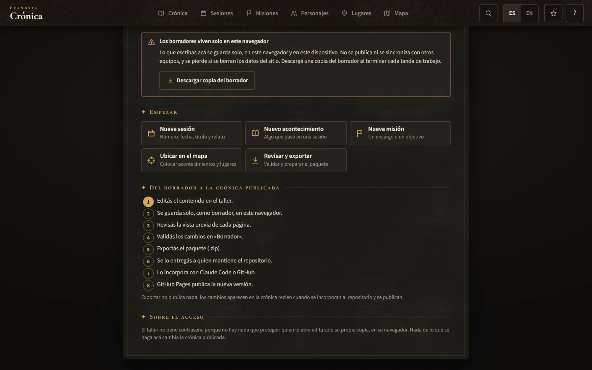
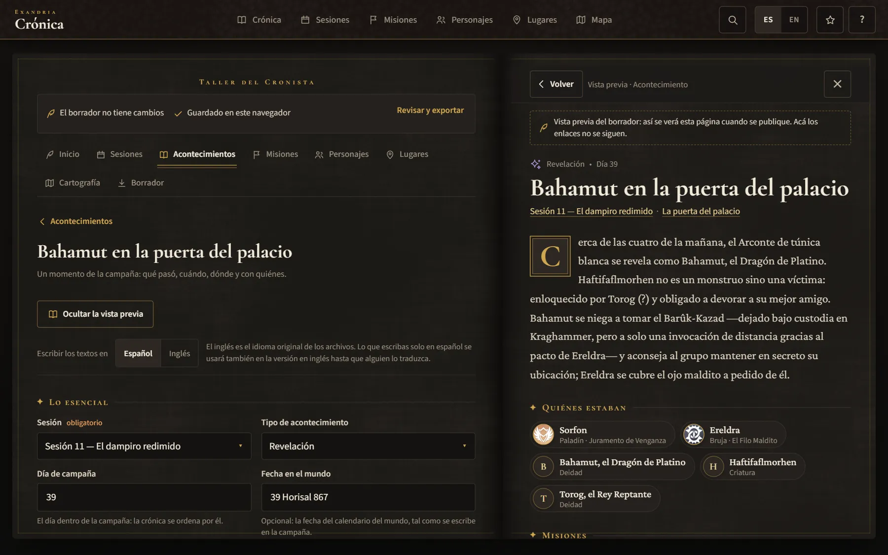
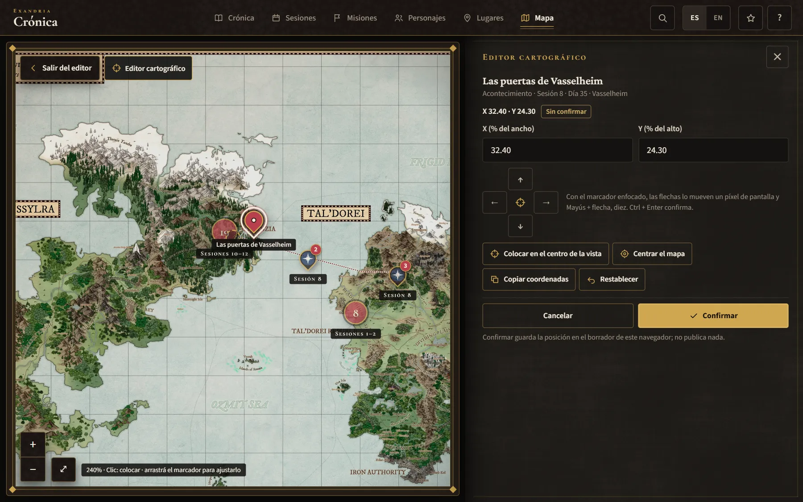
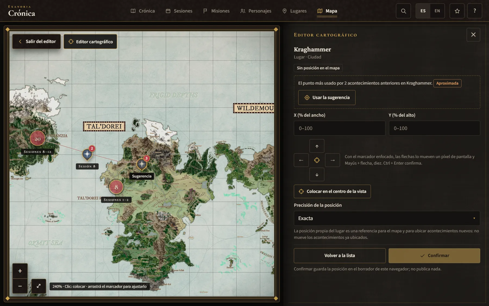
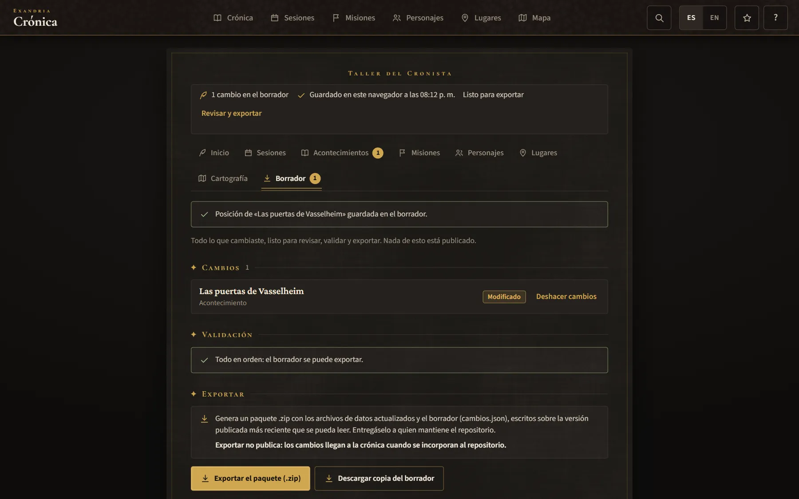

# Guía del Taller del Cronista

Esta guía es para quien lleva la crónica de la campaña —normalmente el Dungeon Master—. Explica paso a paso cómo preparar sesiones, acontecimientos, misiones, personajes y lugares en el **Taller del Cronista**, cómo ubicarlos en el mapa con el **Editor cartográfico** y cómo entregar el resultado para que se publique.

← [Volver al README](../README.md) · Documentación técnica (en inglés): [Modelo de datos](data-model.md) · [Sistema del mapa](map-system.md) · [Desarrollo](development.md)

> [!IMPORTANT]
> **Exportar no es publicar.** El Taller funciona entero en tu navegador, sin servidor propio. Lo que escribís queda como borrador en tu equipo; cuando exportás, se descarga un paquete `.zip`. Los cambios aparecen en la crónica pública recién cuando alguien incorpora ese paquete al repositorio y GitHub Pages publica la nueva versión.

**Índice:** [Antes de empezar](#antes-de-empezar) · [1. Entrar](#1-cómo-entrar-al-taller) · [2. Crear una sesión](#2-cómo-crear-una-sesión) · [3. Agregar acontecimientos](#3-cómo-agregar-acontecimientos) · [4. Vincular](#4-cómo-vincular-personajes-lugares-y-misiones) · [5. Editor cartográfico](#5-usar-el-editor-cartográfico) · [6. Guardar](#6-cómo-se-guardan-los-borradores) · [7. Recuperar](#7-cómo-recuperar-el-trabajo) · [8. Revisar y validar](#8-cómo-revisar-y-validar-los-cambios) · [9. Exportar](#9-cómo-exportar) · [10. Entregar](#10-cómo-entregar-el-paquete-para-publicarlo) · [Qué no se edita en el Taller](#qué-no-se-edita-en-el-taller) · [Problemas frecuentes](#problemas-frecuentes)

## Antes de empezar

- **Qué es.** Un escritorio dentro de la propia crónica: formularios para cada tipo de registro, una vista previa que muestra la página tal como se publicará y el mapa real para ubicar acontecimientos y lugares.
- **Qué no es.** No es un sistema con cuentas ni sincronización: no hay usuario, contraseña ni nube. No publica nada por sí mismo.
- **Sin contraseña, a propósito.** Quien abre el Taller edita solo su propia copia, en su navegador. Nada de lo que se haga ahí cambia la crónica publicada, que solo cambia a través del repositorio.
- **Bilingüe.** Los archivos de la crónica tienen el inglés como idioma original y el español como traducción. Podés escribir en el idioma que prefieras; el Taller mantiene los dos alineados.

> [!WARNING]
> **Los borradores viven solo en este navegador y en este dispositivo.**
> - No se sincronizan entre equipos ni entre navegadores.
> - Si se borran los datos del sitio (historial, cookies y datos de sitios, limpieza del navegador), **el borrador se pierde**.
> - En una ventana privada lo escrito se pierde al cerrarla.
>
> Por eso conviene usar **Descargar copia del borrador** al terminar cada tanda de trabajo y guardar ese archivo fuera del navegador.

## 1. Cómo entrar al Taller

- **Por su dirección:** agregá `#/taller` a la dirección de la crónica — por ejemplo `https://bottadev.github.io/dnd-campaign-map/#/taller` — y guardala en marcadores.
- **Desde la ayuda:** botón **?** de la barra superior (en el teléfono, **Más → Ayuda**). La última línea dice *¿Llevás la crónica de la campaña? Las sesiones nuevas se preparan en el* **Taller del Cronista**.

El Taller no aparece como pestaña y los visitantes de la crónica nunca lo descargan: se carga solo cuando lo abrís. Después del primer uso con conexión también abre sin conexión.



**Cómo está organizado:**

- **La barra de estado**, siempre visible: cuántos cambios tiene el borrador, si están guardados (*Guardado en este navegador a las…*), si hay errores por corregir o está *Listo para exportar*, conflictos y posiciones sin confirmar, y el enlace **Revisar y exportar**.
- **Las secciones:** **Inicio**, **Sesiones**, **Acontecimientos**, **Misiones**, **Personajes**, **Lugares**, **Cartografía** y **Borrador**. Cada una muestra cuántos cambios tiene.
- **Inicio** reúne el aviso sobre los borradores locales con el botón **Descargar copia del borrador**, los accesos rápidos (**Nueva sesión**, **Nuevo acontecimiento**, **Nueva misión**, **Ubicar en el mapa**, **Revisar y exportar**), los últimos cambios y el camino *Del borrador a la crónica publicada*, que marca en qué paso estás.

Cada sección tiene un buscador y un botón para crear registros nuevos. Al abrir un registro se ve su formulario; en pantallas anchas, la vista previa aparece a la derecha, como la página derecha del libro abierto.

## 2. Cómo crear una sesión

1. En **Inicio** o en **Sesiones**, tocá **Nueva sesión**.
2. En el cuadro que se abre ya vienen sugeridos el **Número de sesión** (el siguiente) y la **Fecha en que se jugó** (el día de hoy). Completá el **Título**, corregí la fecha si hace falta y tocá **Crear**.
3. Se abre el formulario de la sesión. Completá lo que corresponda:

| Sección del formulario | Qué va ahí |
|---|---|
| **La sesión** | Número (se puede cambiar mientras la sesión sea nueva), fecha en que se jugó y título. Título y fecha son obligatorios. |
| **Dónde empezó y dónde terminó** | Dónde empezó, dónde terminó, el reloj del mundo al empezar y al terminar (por ejemplo *39 Horisal 867 — al amanecer*) y el último descanso. |
| **Acontecimientos de la sesión** | La lista de sus acontecimientos. Las flechas ↑ ↓ los reordenan dentro de un mismo día; **Agregar un acontecimiento a esta sesión** crea uno nuevo ya vinculado. |
| **Hilos abiertos** | Las tramas que siguen abiertas al terminar: nombre del hilo, misión del hilo, cómo quedó, quién es quién y notas. **Pasar a cerrados** lo mueve a los cerrados. |
| **Hilos cerrados en esta sesión** | Las tramas que se cerraron, con su nota de cierre. **Reabrir** las devuelve a abiertas. |
| **Al terminar la sesión** | Efectos activos (maldiciones, heridas, bendiciones…). |
| **Anteriormente en… (opcional)** | Un resumen para leer en voz alta y entre 3 y 5 momentos destacados de esta sesión. Sin esto, *Anteriormente en…* lista todos los acontecimientos de la sesión. |

> [!TIP]
> **Escribir los textos en** (arriba de cada formulario) elige el idioma en que escribís. Debajo de cada campo se ve lo que dice el otro idioma. Lo que escribas solo en español se usará también en la versión en inglés hasta que alguien lo traduzca; la validación lo avisa, pero no impide exportar.

Escribí solo lo que pasó o se estableció en la mesa. Si algo es una teoría del grupo, decilo así («El grupo sospecha que…») o dejalo afuera.

## 3. Cómo agregar acontecimientos

Un acontecimiento es un momento de la campaña: qué pasó, cuándo, dónde y con quiénes. Es lo que aparece como tarjeta en la Crónica.

1. Tocá **Nuevo acontecimiento** (en Inicio o en Acontecimientos) y elegí la sesión, o usá **Agregar un acontecimiento a esta sesión** desde el formulario de la sesión (toma el día del último acontecimiento de esa sesión).
2. El identificador interno se genera solo, con la forma `s<sesión>_<número>` (por ejemplo `s13_01`). Si cambiás la sesión de un acontecimiento nuevo, el identificador se renueva solo.
3. Completá el formulario:

| Sección | Campos |
|---|---|
| **Lo esencial** | **Sesión** (obligatoria), **Tipo de acontecimiento** (encuentro, conversación, revelación, visión divina, sueño, decisión, descubrimiento, combate, hito de misión, viaje, otro plano, descanso y ritos), **Día de campaña** (la crónica se ordena por él), **Fecha en el mundo** (opcional), **Título** y **Resumen** (obligatorios; una o dos oraciones: es lo que muestra la tarjeta), **Etiqueta de la escena** — con el botón **Armar la etiqueta con el día y el lugar**. |
| **Dónde** | **Lugar** (elegí el más preciso que se conozca: mejor un sitio dentro de una ciudad que la ciudad) y **Posición en el mapa** ([paso 5](#5-usar-el-editor-cartográfico)). |
| **Quiénes** | **Personajes del grupo** y **Personajes no jugadores, deidades y facciones**. |
| **Misiones y conexiones** | **Misiones** y **Acontecimientos relacionados**. |
| **Relato ampliado (opcional)** | **Relato completo**, **Qué cambió** y **Qué quedó sin resolver**: solo para los momentos importantes; se muestran únicamente en la página del acontecimiento. |

En **Avanzado** están el identificador interno, el **Orden dentro del día** (solo si dos acontecimientos del mismo día quedan en el orden equivocado) y el botón para eliminar.

**La vista previa** es la página pública misma, armada con el borrador. En pantallas anchas está a la derecha y sigue lo que escribís (**Ocultar la vista previa** / **Mostrar la vista previa**); en el teléfono se abre con **Vista previa**. Sus enlaces no se siguen: nada de eso está publicado todavía.



## 4. Cómo vincular personajes, lugares y misiones

En el Taller **nunca se escriben identificadores**: personas, lugares, misiones, sesiones y acontecimientos se eligen de listas (botones, listas filtrables, el árbol de lugares).

- **Personajes del grupo**: botones, uno por personaje. Los personajes no jugadores, deidades y facciones van en su propia lista.
- **Lugar**: un árbol de lugares; el acontecimiento cuenta también para los lugares que contienen al elegido.
- **Misiones**: si la misión elegida no incluye la sesión del acontecimiento, aparece un aviso con un botón **Agregar la sesión N a la misión**.
- **Acontecimientos relacionados**: alcanza con anotar la conexión en uno de los dos; se muestra en ambos.
- **Desde una misión**: **Estado** (en curso, pendiente, completada, fallida), **Quién la encargó** (si es un personaje registrado, elegilo y queda vinculado; si no, usá **Texto de quién la encargó**), **Resumen** (dónde está la misión ahora), **Objetivos**, **Sesiones en que avanzó**, **Personajes del grupo involucrados** y **Acontecimientos que la mueven** (el vínculo se guarda en cada acontecimiento). Sus lugares salen de sus acontecimientos.
- **Quién es quién** (en los hilos de una sesión): una entrada se vincula con un personaje o un lugar solo si su nombre coincide exactamente con el nombre en inglés o con uno de sus otros nombres. Elegilo de la lista para no fallar; si no, queda como texto libre (sirve para objetos o gente sin registrar).
- **Relaciones entre personajes**: se anotan una sola vez, en cualquiera de los dos: *Qué es para este personaje* (p. ej. «Su alumno») y *Qué es este personaje para el otro* (p. ej. «Su maestro»).

**Registros nuevos:**

| Botón | Dónde | Qué pide |
|---|---|---|
| **Nueva misión** | Inicio, Misiones | Título y estado. |
| **Nuevo lugar** | Lugares | Nombre, tipo de lugar y dónde queda (**Queda dentro de**; nunca el mismo lugar ni uno que quede dentro de él). |
| **Nuevo personaje** | Personajes | Nombre y categoría: persona, deidad, criatura o facción. |

El identificador de una misión, un lugar o un personaje nuevo se arma con su nombre. Los **otros nombres** (alias) sirven para vincular las notas de las sesiones y para buscar; el **nombre en inglés** es el que vincula las notas de las sesiones.

- El formulario de un **personaje** no jugador, deidad, criatura o facción tiene nombre, otros nombres, categoría, raza o tipo, papel o rol, facciones y relaciones.
- El de un **lugar** tiene nombre, otros nombres, tipo de lugar, dónde queda y su posición propia en el mapa con su precisión.
- Los **personajes del grupo** se pueden editar (nombre, otros nombres, papel —clase y subclase—, color en el mapa, retrato entre las imágenes de la crónica, relaciones), pero no se crean ni se eliminan desde el Taller.

## 5. Usar el Editor cartográfico

El Editor cartográfico abre el mapa real —la misma imagen, marcadores y recorridos— para colocar un acontecimiento o un lugar con un clic, arrastrarlo o ajustarlo con el teclado. Las coordenadas se calculan solas y no dependen del zoom ni de la pantalla.

**Cómo abrirlo:**

- **Cartografía** → **Ubicar en el mapa**. Esa sección también lista los *Acontecimientos sin ubicar* (cada uno con su botón) y la *Posición propia de los lugares*.
- En el formulario de un acontecimiento o un lugar: **Ubicar en el mapa** o **Ajustar en el mapa** (al confirmar o cancelar, volvés al formulario).
- El acceso rápido **Ubicar en el mapa** de Inicio.

**Paso a paso:**

1. **Elegí qué ubicar** en el panel —**Acontecimientos** o **Lugares**, con buscador, filtro por sesión y *Todos / Sin ubicar / Ubicados*— o tocando un marcador del mapa (si el marcador tiene varios acontecimientos, elegís cuál).
2. **Colocalo**: un clic (o un toque) en el mapa pone el marcador ahí. Arrastrar el mapa no coloca nada: solo lo mueve.
3. **Ajustalo**:
   - arrastrando el marcador (el mapa no se mueve mientras lo sostenés);
   - con las **flechas del teclado** con el marcador enfocado: un píxel de pantalla por vez, **Mayús + flecha** diez;
   - con los botones de flecha del panel;
   - escribiendo **X (% del ancho)** e **Y (% del alto)** (sirve `42.5` o `42,5`);
   - con **Colocar en el centro de la vista**, **Centrar el mapa**, **Copiar coordenadas** y **Restablecer** (vuelve a donde estaba antes de esta edición).
4. **Confirmá** (**Confirmar**, o **Ctrl + Enter** con el marcador enfocado) para guardar la posición en el borrador. **Cancelar** (o **Esc**) descarta el movimiento.

Mientras no confirmás, el panel dice *Sin confirmar*, la posición anterior queda marcada con un anillo punteado unido al marcador por un hilo, y la barra de estado del Taller cuenta las posiciones sin confirmar. Cada registro tiene su propio movimiento pendiente: un error en uno nunca mueve otro.



**Sugerencias.** Si un acontecimiento todavía no tiene posición, el editor propone una a partir de lo registrado —nunca inventa— y dice de dónde sale: la posición propia del lugar; el punto más usado por acontecimientos anteriores en ese lugar; el de los lugares que contiene; o la zona del lugar donde queda. Se aplica solo con **Usar la sugerencia** y después se ajusta y confirma como cualquier posición. Si no hay ninguna posición conocida, el editor lo dice y lo colocás a mano.



**Lugares.** Un lugar puede tener su **posición propia**, con su **Precisión de la posición**: *Exacta* (marcada sobre el lugar mismo) o *Aproximada* (más o menos por ahí). Es una referencia para el mapa y para ubicar acontecimientos nuevos: **no mueve los acontecimientos ya ubicados**. Los lugares de otro plano no se marcan en el mapa de Exandria.

En el teléfono el panel se achica a una barra cuando elegís qué ubicar, para que el mapa quede libre: tocá el mapa para colocar y arrastrá el marcador para ajustar.

> [!NOTE]
> Confirmar guarda la posición en el borrador de este navegador; no publica nada. Los recorridos (las líneas punteadas del mapa) no se editan desde el Taller.

## 6. Cómo se guardan los borradores

- **Solo.** Cada cambio se guarda un instante después de hacerlo, sin botón de guardar. La barra de estado lo dice: *Guardando en este navegador…* → *Guardado en este navegador a las…* con la hora.
- **Dónde.** En el almacenamiento del navegador (IndexedDB, base `chronicle-taller`), aparte de la crónica pública. El borrador guarda solo los registros que cambiaste, cada uno con la versión publicada de la que partiste.
- **Cuánto dura.** Sobrevive a cerrar la página, a recargar y a las actualizaciones de la crónica. Cuando el navegador lo permite, el Taller le pide conservar sus datos aunque le falte espacio; si acepta, Inicio muestra *Este navegador aceptó conservar los datos del taller aunque le falte espacio.*
- **Copia en un archivo.** **Descargar copia del borrador** (en Inicio y en Borrador) descarga `taller-borrador-AAAA-MM-DD-HHMM.json`. Guardala fuera del navegador: en una carpeta, en la nube o mandándotela por mail.
- **Ventanas privadas.** Si el navegador no deja guardar (ventana privada, datos del sitio bloqueados), aparece *Este navegador no deja guardar el borrador*: se trabaja en memoria y todo se pierde al cerrar la página. Descargá una copia antes de salir.
- **Al cerrar la página** con un guardado pendiente o una posición sin confirmar en el mapa, el navegador pregunta antes de salir.

## 7. Cómo recuperar el trabajo

| Situación | Qué hacer |
|---|---|
| Volvés otro día, en el mismo navegador y equipo | Abrí el Taller: el borrador está ahí. |
| Querés seguir en otro equipo o navegador | En el original, **Descargar copia del borrador**. En el nuevo: **Borrador** → **Importar** → **Elegir un archivo (.json o .zip)**. Si ya había cambios, el Taller pregunta: **Combinar** o **Reemplazar el mío**. |
| Te arrepentiste de un cambio en un registro | **Deshacer cambios** (vuelve a como está publicado) o, si era nuevo, **Descartar**. Un registro eliminado vuelve con **Deshacer la eliminación**. |
| Querés volver a una versión anterior de todo el borrador | **Borrador** → **Copias de seguridad** → **Restaurar**. El borrador actual se guarda antes como copia. |
| El Taller estaba abierto en dos pestañas | Si otra pestaña guardó después, esta deja de guardar y avisa (*El borrador cambió en otra pestaña*): **Cargar la versión guardada** o **Quedarme con esta** (la otra queda como copia de seguridad). |
| El borrador guardado no se pudo leer | Se conserva como copia de seguridad y empezás uno nuevo; podés restaurarlo desde las copias. |
| Querés empezar de cero | **Borrador** → **Empezar de nuevo** → **Descartar todo el borrador** (antes se guarda una copia). |

**Copias de seguridad automáticas.** Antes de cada operación que reemplaza o descarta trabajo —descartar todo, importar, restaurar, resolver un conflicto, quitar cambios ya publicados— y cada vez que el Taller se abre con cambios, se guarda una copia del borrador en este navegador. Se conservan las 30 más recientes, con su fecha y el motivo (*Al abrir el taller*, *Antes de descartar todo*…). Ojo: también viven en el navegador, así que no reemplazan a la copia descargada.

También se puede importar un archivo de datos (`events.json`, `quests.json`, `es-AR.json`…): sus diferencias con lo publicado se suman al borrador, y lo que falte en el archivo nunca se elimina.

## 8. Cómo revisar y validar los cambios

Todo se revisa en la sección **Borrador**:



1. **Cambios.** La lista de todo lo que cambiaste, marcado como *Nuevo*, *Modificado* o *Eliminado*, con **Deshacer cambios** o **Descartar** en cada uno. Tocá un registro para abrir su formulario y su vista previa.
2. **Conflictos con la versión publicada.** Si un registro que estás editando cambió también en la crónica publicada (por ejemplo, alguien corrigió algo en el repositorio), aparece acá con una tabla —*Campo*, *Cuando empezaste*, *Tu versión*, *Publicada ahora*— y las opciones **Combinar las dos** (cuando no cambió el mismo campo en ambos lados), **Quedarme con la mía**, **Usar la publicada** o, para un registro nuevo cuyo identificador ya existe, **Darle otro identificador a la mía**. Nada se sobrescribe sin que lo decidas.
3. **Validación.** El borrador se revisa con las mismas reglas que el validador del repositorio, más los controles de cada formulario. Los **errores** impiden exportar; los **avisos** no. **Marcar todos los errores en los formularios** los muestra debajo de cada campo.

Errores frecuentes: falta un título, un resumen o un nombre; una fecha que no es `AAAA-MM-DD`; un acontecimiento en una sesión que no existe; una posición con una sola coordenada; un lugar dentro de sí mismo; momentos destacados de otra sesión; un registro que no se puede eliminar porque otros lo mencionan.

Si un cambio tuyo ya está en la versión publicada (porque tu exportación anterior se incorporó), sale solo del borrador —con copia de seguridad— y el Taller avisa cuántos salieron.

## 9. Cómo exportar

1. En **Borrador**, tocá **Exportar el paquete (.zip)**. El botón se habilita cuando hay cambios, sin errores ni conflictos.
2. Antes de escribir el paquete, el Taller vuelve a leer la versión publicada, para escribir sobre la más reciente. Sin conexión usa la última copia guardada y lo avisa: conviene exportar con conexión.
3. Se descarga `cronica-cambios-AAAA-MM-DD-HHMM.zip` y aparece el mensaje *Cambios exportados correctamente. Todavía no están publicados.*

Qué contiene el paquete:

| Archivo | Para qué |
|---|---|
| `LEEME.txt` | Qué contiene, la lista de cambios, el aviso de que **todavía no están publicados** y cómo incorporarlos. |
| `cambios.json` | El borrador: solo los registros que cambiaron, cada uno con la versión de la que partió. Sirve para incorporarlo con seguridad y para volver a abrirlo en el Taller. |
| `data/<archivo>.json` | Cada archivo de datos que cambia, completo y ya actualizado sobre la versión publicada. Los que no cambian no se incluyen. |

Si no se puede abrir un `.zip`, **Descargar los archivos sueltos** baja los mismos archivos de a uno. Exportar no vacía el borrador: los cambios siguen ahí hasta que se publiquen (entonces salen solos) o los descartes.

## 10. Cómo entregar el paquete para publicarlo

1. **Entregá el `.zip`** a quien mantiene el repositorio de la crónica (por mail, chat o una carpeta compartida).
2. **Esa persona lo incorpora.** La forma recomendada, con Claude Code o una terminal en el repositorio:

   ```bash
   node tools/apply-draft.js cronica-cambios-2026-10-19-2130.zip --check
   node tools/apply-draft.js cronica-cambios-2026-10-19-2130.zip
   npm test
   ```

   La herramienta aplica solo tus cambios sobre los archivos actuales, así que no pisa nada de lo publicado después de tu exportación. Si algo que editaste cambió en el repositorio mientras tanto, se detiene y lista los conflictos: en ese caso te puede pedir que importes el borrador, los resuelvas en **Borrador** y vuelvas a exportar. Los detalles para quien mantiene el repositorio están en [Desarrollo › Incorporating the DM's changes](development.md#incorporating-the-dms-changes) (en inglés).
3. **Se revisan las diferencias, se hace commit y push**, y **GitHub Pages publica la nueva versión** en unos minutos.
4. **La próxima vez que abras el Taller**, los cambios ya publicados salen solos del borrador, así que solo queda lo que sigue pendiente.

> [!CAUTION]
> Sin terminal, el paquete también se puede subir desde la web de GitHub reemplazando los archivos de `data/` por los del paquete, **pero solo si nadie modificó esos archivos desde la fecha de exportación** (figura en `LEEME.txt`). Si no, se perderían cambios publicados mientras tanto.

## Qué no se edita en el Taller

- **Los recorridos** (las líneas punteadas del mapa): son viajes registrados y se cargan a mano en `data/routes.json`.
- **El lore canónico** (de la Critical Role Wiki y la Forgotten Realms Wiki): es canon curado con fuentes y se mantiene en `data/lore.json`.
- **Personajes del grupo nuevos**: se agregan en el repositorio (con su retrato, su color y sus recorridos). Tampoco se eliminan desde el Taller.
- **Retratos nuevos**: la imagen se agrega primero al repositorio (`assets/`) y después se elige en el formulario.
- **Eliminar**: solo se puede eliminar lo que ningún otro registro menciona. Un acontecimiento mencionado por otros acontecimientos o por momentos destacados se puede eliminar quitando esas menciones (**Eliminar y quitar las menciones**).
- **Publicar directamente**: el Taller no publica ni guarda credenciales de GitHub; la publicación siempre pasa por el repositorio.

## Problemas frecuentes

| Situación | Qué pasa y qué hacer |
|---|---|
| **Exportar el paquete (.zip)** está deshabilitado | No hay cambios, hay errores por corregir o conflictos por resolver: el mensaje debajo del botón dice cuál. Si dice que no se pudieron leer las traducciones al español, recargá la página con conexión. |
| *No se guarda en este navegador* | Ventana privada o datos del sitio bloqueados: lo escrito se pierde al cerrar. Descargá una copia del borrador y trabajá en una ventana normal. |
| *El borrador cambió en otra pestaña* | El Taller está abierto en dos pestañas. Elegí **Cargar la versión guardada** o **Quedarme con esta** y seguí en una sola. |
| *La crónica publicada cambió desde que abriste la página* | Se publicó una versión nueva; el Taller ya trabaja sobre ella. Revisá si aparecieron conflictos en **Borrador**. |
| *Sin conexión: se usa la última copia guardada de la crónica* | Podés seguir editando, pero conviene exportar con conexión para escribir sobre la versión más reciente. |
| Una entrada de *Quién es quién* dice *Sin vínculo* | Ningún personaje ni lugar se llama exactamente así. Elegilo de la lista, o agregale ese nombre como *otro nombre* al personaje. |
| No veo mis cambios en la crónica pública | Es lo esperado: aparecen recién cuando se incorporan al repositorio y se publican. La vista previa muestra cómo se verán. |
| Cerré la página y no encuentro mis cambios | Si fue en el mismo navegador y equipo, abrí el Taller y revisá **Borrador** → **Copias de seguridad**. Si fue en una ventana privada o se borraron los datos del sitio, solo se recuperan desde una copia descargada. |
